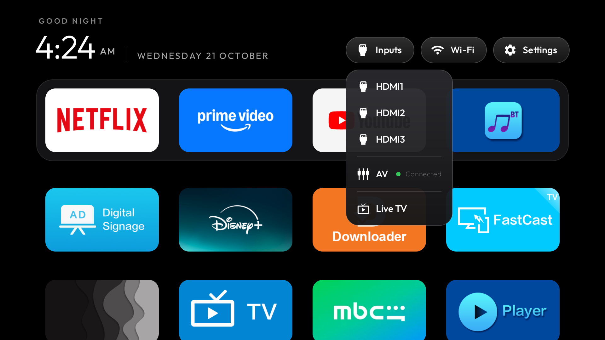

# HAAM HM4K75S11TND: selecting the satellite tuner

Checked on a retail HM4K75S11TND whose Android model is `R4`, Android 11 / API 30,
Realtek `rtd2851m`, software `V8-T851MGL-0001103`, fingerprint
`HAAM/HAAM/R4:11/RTT7.221026.001/3172:user/release-keys`.
These are launcher-routing observations, not a debloat list or firmware compatibility claim.



## Several tuners, one Live TV app

The player is `com.apps.livetv`. It is separate from the packages that supply the
inputs. This firmware registers all four of these as system `TYPE_TUNER` inputs:

| Label | Input ID |
|---|---|
| ATV | `com.apps.atv/.atvinput.AtvInputService/HW33619968` |
| CABLE | `com.apps.dtv/.tvinput.DTVTvInputService/HW33685504` |
| ANTENNA | `com.apps.dtv/.tvinput.DTVTvInputService/HW33685505` |
| SATELLITE | `com.apps.dtv/.tvinput.DTVTvInputService/HW33685506` |

The automatic tuner heuristic picks ATV here: its ID does not contain `analog`.
Even preferring a digital input would not tell the launcher which of cable,
antenna or satellite has the owner's dish connected. Sending a passthrough URI
for the satellite input also opened AV on this firmware. The working route is
the satellite input's **channel collection**, using `TvContract.buildChannelsUriForInput`
and `TvContract.Channels.CONTENT_TYPE`, restricted to `com.apps.livetv`.

For this exact configuration, merge these keys into your theme's `config.json`:

```json
{
  "live_tv_package": "com.apps.livetv",
  "live_tv_input_id": "com.apps.dtv/.tvinput.DTVTvInputService/HW33685506"
}
```

Or set the equivalent strings in `launcher/app/src/main/res/values/config.xml`.
The ID must match a registered system tuner exactly; obtain your own IDs from
`tools/tv.py 'dumpsys tv_input'` rather than copying a number from another model.
If the chosen input is missing, or the configured player cannot resolve the
channel collection, the row opens the normal Live TV app. It does not silently
choose another tuner. Leave `live_tv_input_id` empty to retain existing automatic
selection and OEM routing.

This selects an input, not a particular programme, satellite orbital position or
frequency. The TV's own channel database and player still control tuning. It does
not scan, renumber channels, replace a tuner driver or change dish settings.

## Evidence and limits

On the owner's customized launcher, selecting the satellite collection after AV
opened the satellite input and an existing programme. The owner confirmed normal
picture and sound. The native TV-input session reported `HW33685506`.
The proposed change was also built against upstream commit `687b5ee` and tested
as a separate application on the same TV. With the explicit satellite ID, the
activity launch used the package-restricted channel-collection URI and the active
TV-input session reported `HW33685506`. With a deliberately nonexistent ID, the
launcher instead sent the normal leanback launch intent to the configured Live
TV app. Up/Down/Left/Right were checked at the Inputs popup's first and last rows;
Back closed the popup. The screenshot above is from that test build.

The picture/sound confirmation above belongs to the earlier customized build;
the separate test build was verified through its launch intent and input session.
Do not treat an empty screenshot of the video plane as failed reception; check
the session and ask the person watching the TV.

The TV reports AV as connected even with its jack empty. Its inactive HDMI ports
report standby whether a cable is attached or not. Those state reports cannot
establish physical cable presence. This tuner-selection change does not alter
the connection indicators or hide any input rows.
